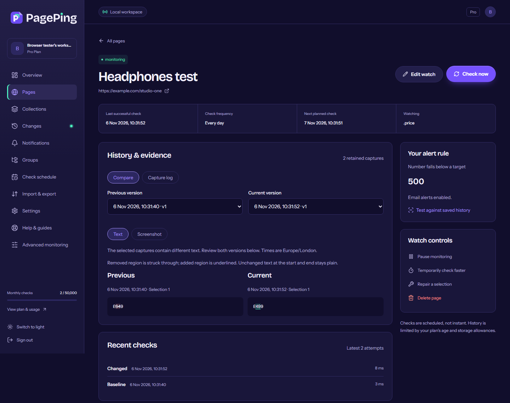
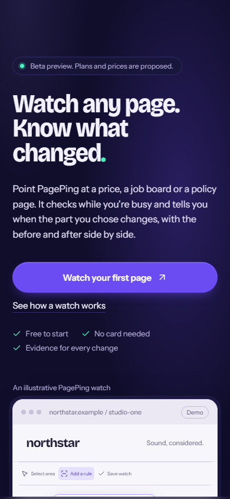
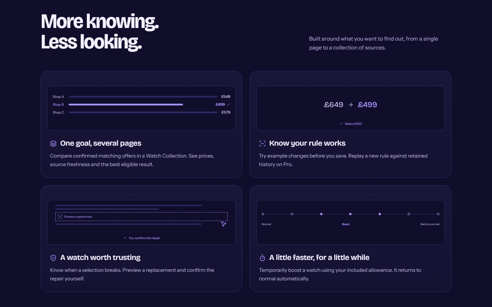
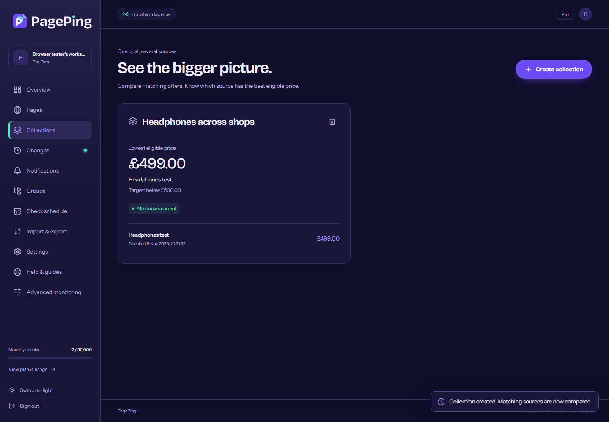

  <picture>
    <source media="(prefers-color-scheme: dark)" srcset="assets/pageping-wordmark-on-dark.svg">
    
  </picture>

<h3 align="center">Watch any page. Know what changed.</h3>

  Website change monitoring for the parts of a page you actually care about. 
  <strong>In development · local beta · not yet available to the public</strong>

  <a href="ROADMAP.md">Roadmap</a> ·
  <a href="CHANGELOG.md">Product updates</a> ·
  <a href="FAQ.md">FAQ</a>

## What PagePing does

Point PagePing at a public page, such as a product, a job board or a policy page. Select the part that matters, say when you want to hear about it, and PagePing checks on a schedule. When the part you chose changes in a way your rule cares about, you get the before and the after, side by side.

It is being built for people who check the same pages by hand: small online shops keeping an eye on rivals' prices and stock, the agencies that look after them, and anyone waiting for a price drop, a restock or a new listing.

## What's built so far

Everything below works in the current local build and has been exercised with controlled test data. It has not yet run as a public service.

| Area | In the local build |
|---|---|
| Watching pages | HTTP and full-browser checks, section selection with a preview of what PagePing can see, scheduled checks with per-site throttling |
| Rules | Text, number, price and stock conditions, with a preview of what would and wouldn't trigger an alert before you save |
| Evidence | Before-and-after comparison, text and screenshot views, capture log, number history |
| Watch Collections | One product compared across several pages you choose, showing the lowest eligible price and how fresh each source is |
| Repair | When a selection stops matching, preview a replacement and confirm it yourself |
| Rule replay | Test a new rule against a watch's saved history |
| Speed boosts | Check a watch faster for a while, then return to normal automatically |
| Alerts | Immediate, daily or muted email preferences, grouped changes, notices when a check fails or recovers |
| Accounts and teams | Sign-up, verification, password reset, shared workspaces with roles, data import and export |

<table>
  <tr>
    <td width="66%"></td>
    <td width="34%"></td>
  </tr>
  <tr>
    <td>A watch's evidence: what changed, when, and why the rule matched (local build, test data).</td>
    <td>The landing page at phone width.</td>
  </tr>
</table>

## Current status

**Local development beta. Not publicly launched, and nothing is for sale yet.**

- Hosting, production email, live payments and an independent security review are separate steps still to come. See the [roadmap](ROADMAP.md).
- Plans and prices shown in previews are proposals, not an offer. Checkout in the local build is test-only.
- The demonstration shop, products and prices in these screenshots are illustrative, not a real merchant.
- PagePing checks public pages only. It does not log in to sites or try to get round blocks, so some websites will not work with it.

## Follow along

- [Roadmap](ROADMAP.md): what's done, what's next and what comes after.
- [Product updates](CHANGELOG.md): what changed and when.
- [FAQ](FAQ.md): common questions about status, pricing and how monitoring works.
- Watch or star this repository to hear about public updates.

This repository presents the product and its progress. It contains product information and preview images only. The application source is maintained privately, and there is no self-hosting distribution.
